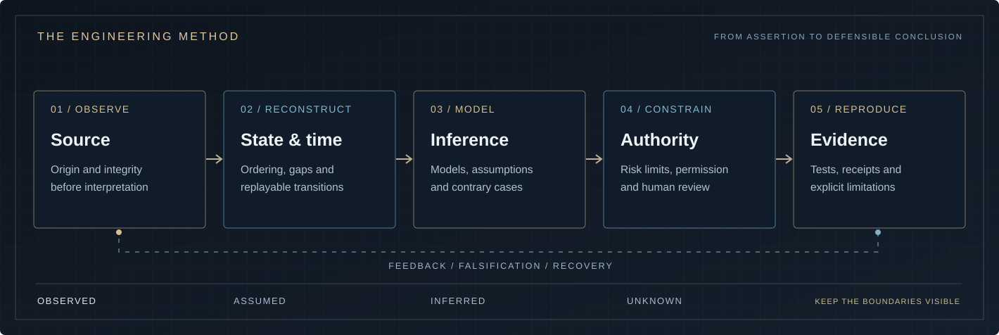

[ORCID](https://orcid.org/0009-0003-6812-8406) &nbsp;·&nbsp; [Research correspondence](mailto:julianvanceblackwood@gmail.com)

---

## Perspective

I study systems in which information, capital and authority have to move under imperfect conditions. Prices may be stale. Events arrive out of order. A valid signature may authorize the wrong action. A sensor may be silent for reasons other than safety. A correct algorithm can still produce an indefensible decision when the surrounding system fails.

My interests span quantitative finance, digital asset infrastructure, cryptographic protocols, hardware assurance, defensive cybersecurity and intelligence engineering. I approach them through shared questions: **what is known, which assumptions are being made, who has authority, and what evidence survives when something goes wrong?**

The aim is not to make a system appear more certain. It is to make its behavior, failure modes and limits easier to examine.

**Understand the system. Define the risk. Verify the result.**

## Research domains

<table>
<tr>
<td width="50%" valign="top">

01 / PRIMARY FOCUS

<h3>Finance &amp; Quantitative Systems</h3>

Market structure, pricing assumptions, probability and statistics, research validation, portfolio exposure, execution mechanics and risk controls.

I am interested in the complete path from market observation to a defensible financial action: the data, model, order state, accounting and operational limits that stand between a backtest and reality.

MARKET MICROSTRUCTURE · MODEL RISK · C++ · PYTHON

</td>
<td width="50%" valign="top">

02 / CAPITAL & PROTOCOLS

<h3>Crypto &amp; Digital Assets</h3>

Custody, authorization, transaction intent, key management, market integrity, reconciliation and settlement uncertainty.

Cryptographic validity is only part of the problem. I study how permission, ownership, economic exposure and recovery interact with the underlying software and operational controls.

CUSTODY · CRYPTOGRAPHY · SETTLEMENT · RISK

</td>
</tr>
<tr>
<td width="50%" valign="top">

03 / DISTRIBUTED STATE

<h3>Blockchain Engineering</h3>

Consensus assumptions, transaction ordering, deterministic validation, chain reorganizations, bridge dependencies and finality.

A transaction being broadcast, signed or accepted by an API does not establish every property a system may need. Protocol guarantees must be separated from assumptions inherited from networks and counterparties.

STATE MACHINES · CONSENSUS · REPLAY · PROTOCOLS

</td>
<td width="50%" valign="top">

04 / BELOW SOFTWARE

<h3>FPGA &amp; Hardware Assurance</h3>

RTL design, bounded-latency computation, fixed-width arithmetic, deterministic sequencing, digital interfaces and hardware/software trust boundaries.

I examine where hardware meaningfully improves timing, isolation, integrity or reliability—and where simulation must not be confused with physical security or a deployed device.

SYSTEMVERILOG · VERIFICATION · TIMING · DIGITAL LOGIC

</td>
</tr>
<tr>
<td width="50%" valign="top">

05 / ADVERSARIAL CONDITIONS

<h3>Cybersecurity &amp; Secure Systems</h3>

Operating systems, networking, secure architecture, reverse engineering, digital forensics, threat modeling and evidence preservation.

The emphasis is defensive and authorized work: understanding who can act, what they can affect, which records can be trusted and what a system can recover after compromise.

DEFENSIVE SECURITY · FORENSICS · SYSTEMS · TRUST

</td>
<td width="50%" valign="top">

06 / JUDGMENT UNDER UNCERTAINTY

<h3>Intelligence &amp; Decision Systems</h3>

Source provenance, temporal reconstruction, entity relationships, conflicting hypotheses, observable gaps, consequence analysis and human accountability.

An authentic record can still be wrong. Multiple agreeing sources may share a dependency. Analytical confidence must never silently become authority to intervene.

PROVENANCE · OBSERVABILITY · UNCERTAINTY · REVIEW

</td>
</tr>
</table>

## Engineering method

A model is useful only to the extent that its assumptions and constraints remain inspectable. I prefer small, coherent systems with explicit contracts, independent reference behavior and tests that can expose incorrect conclusions.

  

The working discipline is consistent across domains:

1. **Define the boundary.** Identify the actors, authority, inputs, state transitions and what remains outside the model.
2. **Build a reference.** Start with an implementation whose behavior can be inspected before optimizing it.
3. **Challenge the assumptions.** Test malformed input, missing observations, correlated failures, clock disagreement and adversarial conditions.
4. **Measure what matters.** Preserve test conditions, units, workload, latency distributions, numerical error and resource constraints.
5. **Keep decisions attributable.** Connect a conclusion to its evidence, policy and version. Distinguish an observation from an inference and an inference from authorization.

Failures that invalidate a hypothesis are part of the result, not something to hide in the presentation.

## Technical foundation

| Layer | Areas of work and continued study |
| :--- | :--- |
| **Quantitative** | Probability, statistics, numerical methods, time-series research, optimization and financial risk |
| **Systems** | C, C++, Python, Linux, memory, concurrency, networking and performance measurement |
| **Cryptographic** | Hashing, signatures, authenticated data, serialization, key boundaries and reference vectors |
| **Distributed** | Consensus, ordering, state reconstruction, fault models, idempotency and recovery |
| **Hardware** | Digital logic, electronics, SystemVerilog, FPGA architecture and RTL verification |
| **Security** | Threat modeling, program analysis, forensic evidence, secure interfaces and defensive operations |
| **Intelligence** | Source validation, temporal models, uncertainty, competing explanations and consequence analysis |

These are active technical directions, not a claim of equal experience or mastery in every discipline. Demonstrations, benchmarks and assurance claims must be evaluated at the level actually supported by the implementation.

## Principles

**Evidence before confidence.** A plausible output is not proof of a valid input, a correct model or a justified conclusion.

**Correctness before optimization.** Performance results mean little without test conditions, numerical constraints and reproducible baselines.

**Authority is part of the architecture.** Authentication, permission, economic intent and human approval are different questions.

**Failure is an expected operating condition.** Stale data, unreliable clocks, partial state, dependency failure and recovery belong in the design.

**Build where understanding matters.** Critical parsers, codecs, numerical routines, state machines and reference implementations deserve direct scrutiny; external dependencies deserve the same discipline.

## Independent research & collaboration

I publish research incrementally and distinguish working implementations from proposals, controlled experiments and unverified assumptions. I value technical criticism that identifies a reproducible defect, a counterexample to a model, or an assumption that deserves a better test.

I am open to focused conversations with engineers, researchers and organizations working on quantitative systems, digital asset infrastructure, secure computation, defensive security and evidence-based decision support.

For a technical inquiry, include the problem, relevant constraints and the kind of investigation or collaboration you have in mind. Public research does not imply production readiness, institutional affiliation or permission to reuse code without an applicable license.

---

**UNDERSTAND THE SYSTEM. DEFINE THE RISK. VERIFY THE RESULT.**

JULIAN VANCE BLACKWOOD &nbsp; / &nbsp; INDEPENDENT RESEARCH & SYSTEMS ENGINEERING

[ORCID](https://orcid.org/0009-0003-6812-8406) &nbsp;·&nbsp; [Email](mailto:julianvanceblackwood@gmail.com)

